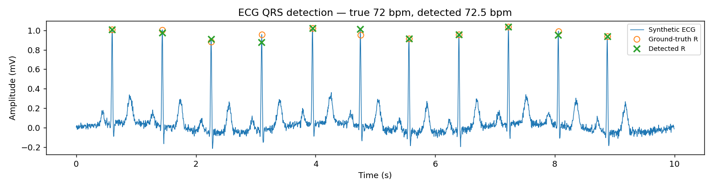

# ECG QRS Detector

A synthetic ECG generator plus a simplified **Pan-Tompkins QRS
detector**, with an honest accuracy check: the generator knows exactly
where it put every R peak, and the detector's output is scored against
that ground truth.

## What it does

1. **`ecg_sim.py`** — generates ~10 s of ECG at 250 Hz and a settable
   heart rate (default 72 bpm). Each beat is a sum of Gaussian bumps
   approximating PQRST morphology, with ~2% heart-rate variability,
   baseline wander, and measurement noise. Returns the ground-truth
   R-peak sample indices alongside the signal.
2. **`qrs_detect.py`** — a simplified Pan-Tompkins pipeline using only
   numpy: FFT bandpass (5–15 Hz) → derivative → squaring →
   moving-window integration (150 ms) → adaptive threshold with a
   200 ms refractory period → refinement to the local maximum of the
   bandpassed signal. Also includes an evaluator (TP/FP/FN,
   sensitivity, precision, ±75 ms matching window) and a mean-BPM
   helper.
3. **`main.py`** — runs the whole flow and writes `results.txt` plus a
   plot (`ecg_plot.png`) with ground-truth and detected peaks marked.

## Requirements

```bash
pip install numpy matplotlib
```

## How to run

```bash
python3 main.py
```

## Example output

Real result of running `main.py` on this machine (full log in
`results.txt`):

```text
Ground-truth beats   : 11
Detected beats       : 11
True positives       : 11
False positives      : 0
False negatives      : 0
Sensitivity          : 100.0%
Precision            : 100.0%
Ground-truth HR      : 72.0 bpm (generator setting)
Detected mean HR     : 72.50 bpm
HR error             : 0.50 bpm
```



Detected peak indices matched the ground truth to within 1 sample on
every beat. Note the 100% scores are on clean synthetic data — real
ECG with motion artefacts and ectopic beats would score lower; the
point of this project is a verifiable end-to-end pipeline, and the
evaluator is there so any change can be measured rather than guessed.

## Files

| File | Description |
|---|---|
| `ecg_sim.py` | Synthetic ECG generator with ground-truth R peaks |
| `qrs_detect.py` | Pan-Tompkins-style detector + evaluator |
| `main.py` | Entry point: generate → detect → evaluate → plot |
| `results.txt` | Captured summary of a real run |
| `ecg_plot.png` | Signal plot with ground-truth vs detected peaks |
